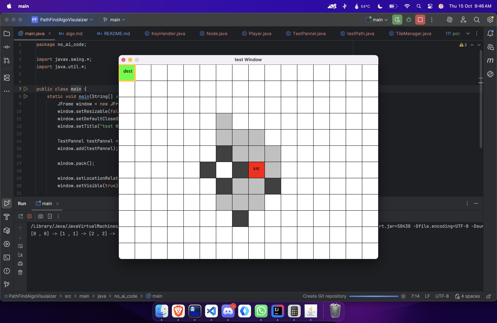
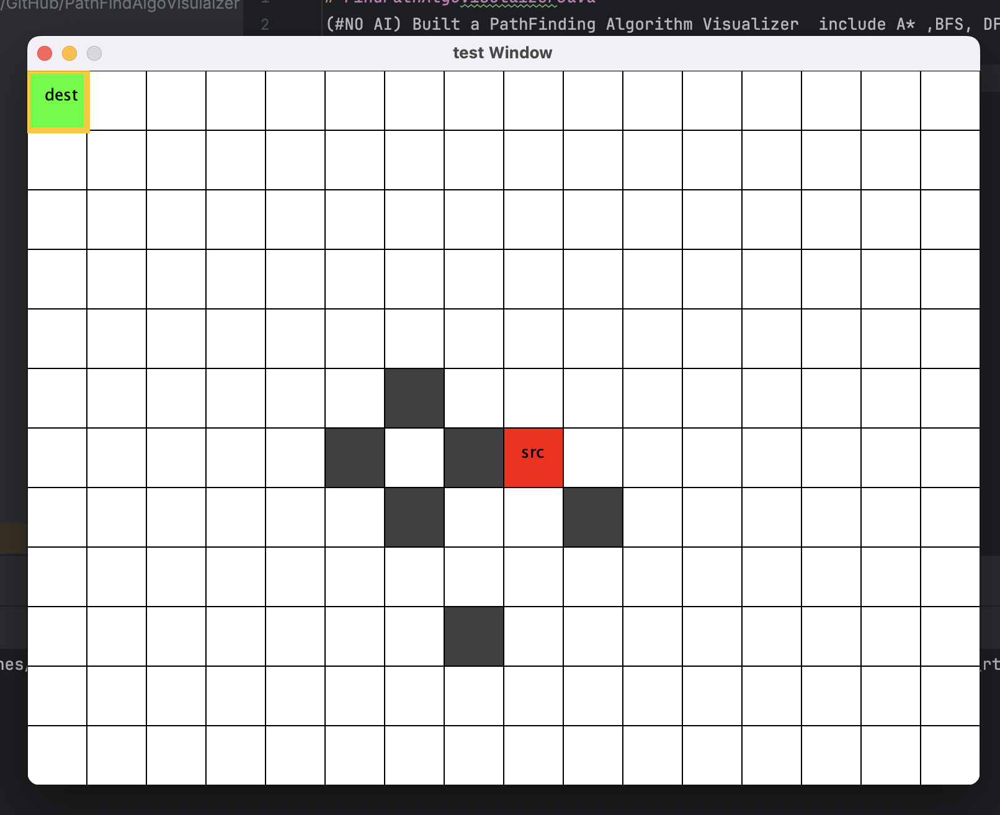
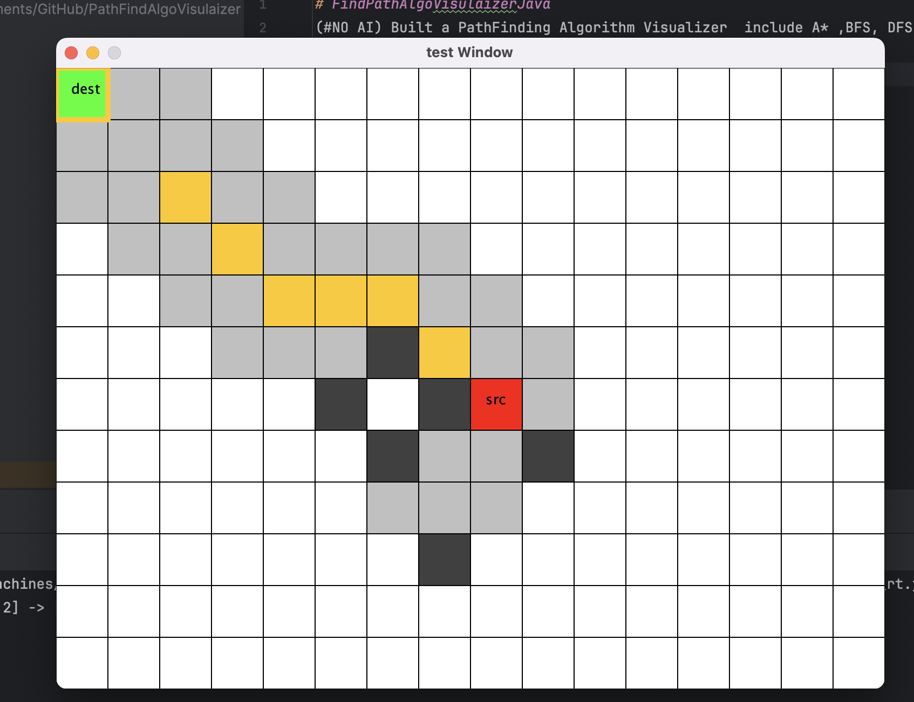
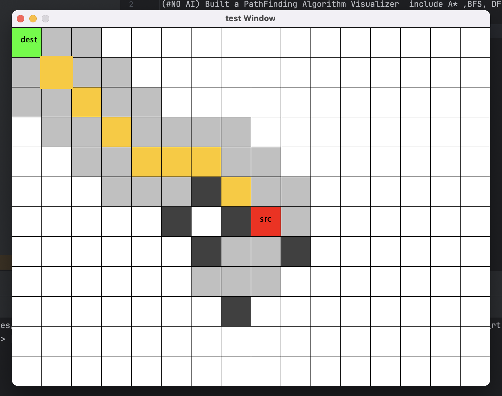

# FindPathAlgoVisulaizerJava
(#NO AI) Built a PathFinding Algorithm Visualizer  include A* ,BFS, DFS

---
## Visuals

### Algorithm : A*

---
## Controls
| Key     | Action inside the Visualiser|
|---------|-----------------------------|
| W/A/S/D | To move the Cursor|
| O       | To Set the Src at Cursor|
| P       | To Set the Dest at Cursor|
| ENTER   | To Re-Run the Searching Algorithm at set point of src and dest|

